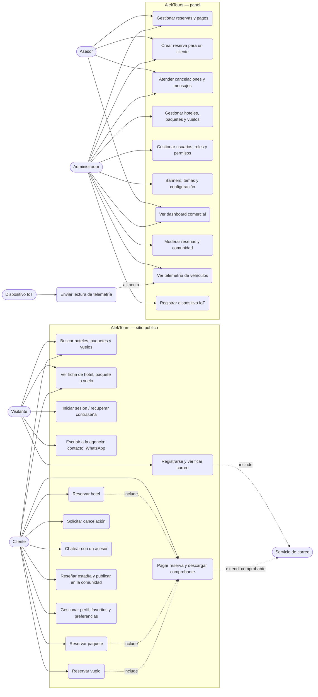
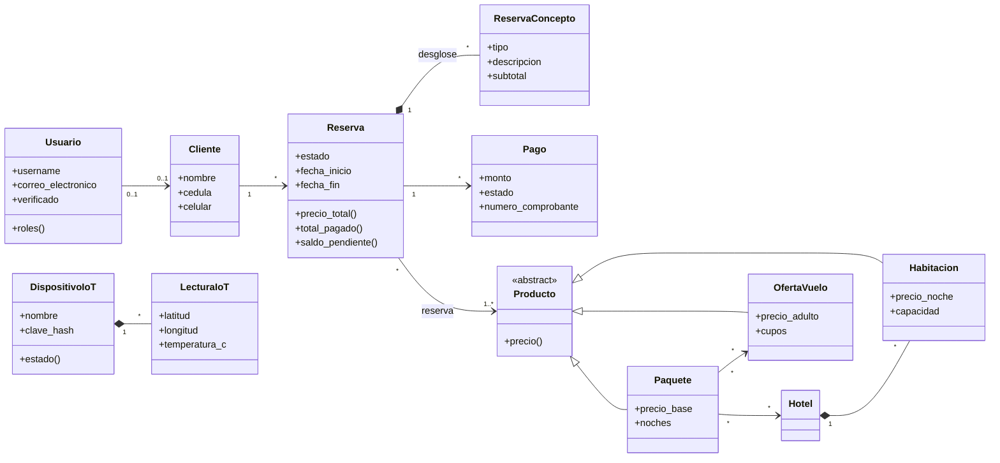
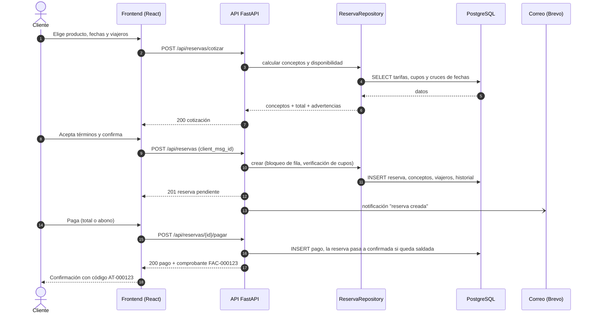
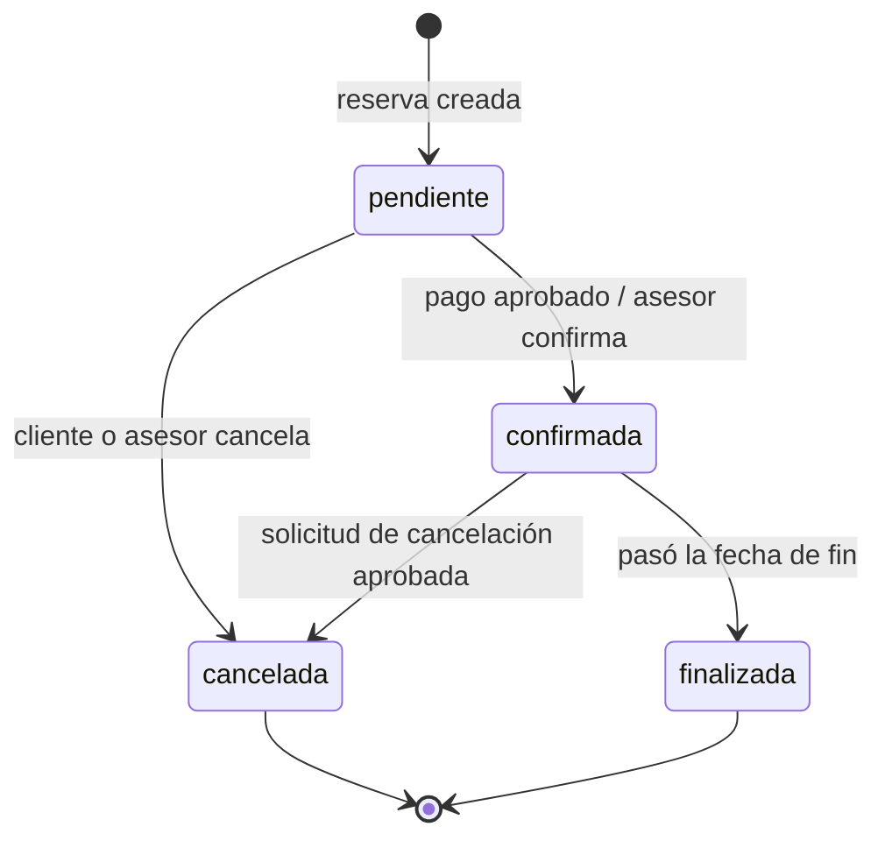

# 1. Documentación general y diagramas

Índice de la documentación del proyecto y los diagramas que la resumen. Los
diagramas están en Mermaid: GitHub los dibuja directamente al abrir el archivo.

| Artefacto | Dónde |
|---|---|
| Requisitos funcionales (RF) y no funcionales (RNF) | [`docs/requisitos/RFs`](../requisitos/RFs), [`docs/requisitos/RNFs`](../requisitos/RNFs), [`restricciones.md`](../requisitos/restricciones.md) |
| Historias de usuario (35, con criterios de aceptación) | [`docs/historias-usuario/`](../historias-usuario/README.md) |
| Casos de uso | §1 de este documento |
| Diagrama de clases UML | §2 de este documento y [`01b-modelo-de-datos.md`](01b-modelo-de-datos.md) §2 |
| MER (entidad-relación) | [`01b-modelo-de-datos.md`](01b-modelo-de-datos.md) §3 (55 tablas, generado desde los modelos) |
| MR (modelo relacional) | [`01b-modelo-de-datos.md`](01b-modelo-de-datos.md) §1 |
| Diccionario de datos | [`docs/referencia-tecnica/database-schema.md`](../referencia-tecnica/database-schema.md), [`tablas.md`](../referencia-tecnica/tablas.md) |
| Diagramas de secuencia y actividad | §3 y §4 de este documento |
| Arquitectura | [`05-arquitectura.md`](05-arquitectura.md) |
| API | [`docs/referencia-tecnica/api-endpoints.md`](../referencia-tecnica/api-endpoints.md) y Swagger en `/docs` |
| Manual de usuario | [`docs/manual-usuario/`](../manual-usuario/README.md) |

## 1. Diagrama de casos de uso

Actores: **Visitante** (sin cuenta), **Cliente**, **Asesor** (empleado),
**Administrador**, el **dispositivo IoT** del vehículo y los servicios externos
(correo Brevo, imágenes Cloudinary).

Cada caso de uso tiene su historia de usuario con criterios de aceptación
(`Dado / cuando / entonces`) en [`docs/historias-usuario/`](../historias-usuario/README.md):
UC1→HU-02/04/05, UC6→HU-10, UC7→HU-11, UC8→HU-12, UC9→HU-13 y HU-20,
UC10→HU-15, UC11→HU-16, UC20→HU-29, UC23→HU-26/27/28, UC24→HU-33, UC26→HU-32.

### Especificación del caso de uso principal: UC6 Reservar hotel

| Campo | Contenido |
|---|---|
| Actor principal | Cliente (con sesión y correo verificado) |
| Precondición | El hotel está publicado y tiene al menos una habitación disponible |
| Flujo básico | 1. Elige hotel, habitación, fechas y huéspedes. 2. El sistema bloquea las noches ocupadas y valida capacidad. 3. Confirma sus datos de viajero. 4. Revisa el desglose (`POST /api/reservas/cotizar`). 5. Acepta términos y confirma (`POST /api/reservas`). 6. Paga total o abono (`POST /api/reservas/{id}/pagar`). 7. Ve la confirmación con el código `AT-000123`. |
| Flujos alternos | 2a. Fechas cruzadas con otra reserva → 409 y aviso. 2b. Más huéspedes que la capacidad → no deja continuar. 6a. Pago rechazado → la reserva queda pendiente y puede pagar después. |
| Postcondición | Reserva en estado `pendiente` o `confirmada`, historial y notificación al cliente y al panel |
| Reglas | El precio lo calcula el backend; el navegador no suma precios. Reserva idempotente (`client_msg_id`) para no duplicar con doble clic |

## 2. Diagrama de clases (dominio de reservas)

Vista resumida con las operaciones de negocio principales. El diagrama con
todos los atributos de las 14 entidades centrales está en
[`01b-modelo-de-datos.md`](01b-modelo-de-datos.md#2-diagrama-de-clases-uml-entidades-centrales).

> `Producto` es una abstracción de análisis (en el código cada producto es su
> propia tabla y la reserva lo referencia por `tipo_producto`).

## 3. Diagrama de secuencia: reservar y pagar

## 4. Diagrama de actividad: estados de una reserva

## 5. Diagrama de despliegue

Ver [`05-arquitectura.md`](05-arquitectura.md#2-despliegue).
