# Modelo de datos (MER, MR y clases)

> Generado por `backend/scripts/generar_modelo_datos.py` desde los modelos
> SQLAlchemy de `backend/app/models/`. No editar a mano: volver a correr el
> script tras cambiar un modelo. Esquema en la base: migraciones de Alembic
> (`backend/alembic/versions/`).

**55 tablas · 70 llaves foráneas** · motor PostgreSQL 16 (Neon en producción).

## 1. Modelo relacional (MR)

Notación: <u>subrayado</u> = llave primaria · `→ tabla.columna` = llave
foránea · (NN) = NOT NULL.

### Usuarios y seguridad

- **usuarios**(<u>id_usuario</u>, username (NN), correo_electronico (NN), password_hash (NN), id_cliente → clientes.id_cliente, id_empleado → empleados.id_empleado, activo, verificado, foto_perfil, ultimo_login, fecha_creacion, terminos_version, terminos_aceptados_en, codigo_verificacion_hash, codigo_verificacion_expira, intentos_verificacion (NN))
- **roles**(<u>id_rol</u>, nombre_rol (NN))
- **permisos**(<u>id_permiso</u>, clave (NN), nombre (NN), categoria (NN))
- **usuarios_roles**(<u>id_usuario</u> → usuarios.id_usuario, <u>id_rol</u> → roles.id_rol, fecha_asignacion)
- **roles_permisos**(<u>id_rol</u> → roles.id_rol, <u>id_permiso</u> → permisos.id_permiso)
- **sesiones_usuario**(<u>id_sesion</u>, id_usuario → usuarios.id_usuario (NN), refresh_token (NN), direccion_ip, user_agent, fecha_creacion, fecha_expiracion, activa)
- **recuperacion_password**(<u>id_recuperacion</u>, id_usuario → usuarios.id_usuario (NN), token_recuperacion (NN), usado, fecha_creacion, fecha_expiracion (NN))

### Clientes y empleados

- **clientes**(<u>id_cliente</u>, nombre (NN), apellido (NN), cedula (NN), correo, celular, direccion, barrio, departamento, codigo_postal, ciudad, pais, fecha_nacimiento, fecha_registro)
- **empleados**(<u>id_empleado</u>, nombre (NN), apellido (NN), cedula (NN), correo_electronico, celular, direccion, ciudad, pais, fecha_nacimiento, fecha_contratacion, activo)
- **preferencias_cliente**(<u>id_preferencia</u>, id_cliente → clientes.id_cliente (NN), intereses, compania, presupuesto, clima, ritmo, transporte, fecha_creacion, fecha_actualizacion)
- **favoritos**(<u>id_favorito</u>, id_cliente → clientes.id_cliente (NN), id_hotel → hoteles.id_hotel (NN), fecha_creacion)
- **metodos_pago_guardados**(<u>id_metodo_guardado</u>, id_cliente → clientes.id_cliente (NN), alias (NN), tipo (NN), ultimos4, clave_hash (NN), predeterminado (NN), fecha_creacion)
- **solicitudes_corporativas**(<u>id_solicitud</u>, nombre_empresa (NN), numero_empleados, nombre_contacto (NN), email_corporativo (NN), telefono (NN), mensaje, estado (NN), fecha_creacion)

### Hoteles

- **hoteles**(<u>id_hotel</u>, nombre_hotel (NN), calificacion, direccion, ciudad, pais, codigo_postal, correo_electronico, telefono, imagen_url, descripcion, politicas, tipo_alojamiento, departamento, sitio_web, latitud, longitud, fuente_calificacion, publicado (NN), hora_checkin, hora_checkout, politica_entrada_anticipada, politica_salida_tardia, edad_minima, politica_ninos, politica_mascotas, politica_cancelacion, condiciones_reserva, impuestos_cargos, restricciones, informacion_adicional)
- **habitaciones**(<u>id_habitacion</u>, id_hotel → hoteles.id_hotel (NN), id_tipo_habitacion → tipo_habitacion.id_tipo_habitacion (NN), numero_habitacion (NN), precio_noche (NN), estado (NN), descripcion, tamano_m2, tipo_cama, vista, comodidades, piso, tipo_bano, servicios, desayuno_incluido, permite_fumar, admite_mascotas, accesible, cama_extra, nombre, capacidad_adultos, capacidad_ninos, cantidad_camas, politica_cancelacion, publicada (NN))
- **tipo_habitacion**(<u>id_tipo_habitacion</u>, nombre_tipo (NN), descripcion, capacidad_personas (NN))
- **caracteristicas_hotel**(<u>id_caracteristica</u>, nombre_caracteristica (NN))
- **hotel_caracteristicas**(<u>id_hotel</u> → hoteles.id_hotel, <u>id_caracteristica</u> → caracteristicas_hotel.id_caracteristica, disponible, estado, nota)
- **imagenes_hotel**(<u>id_imagen</u>, id_hotel → hoteles.id_hotel (NN), url (NN), orden (NN), fecha_creacion)
- **imagenes_habitacion**(<u>id_imagen</u>, id_habitacion → habitaciones.id_habitacion (NN), url (NN), orden (NN), descripcion, fecha_creacion)
- **resenas**(<u>id_resena</u>, id_reserva → reservas.id_reserva (NN), id_cliente → clientes.id_cliente (NN), id_hotel → hoteles.id_hotel (NN), calificacion (NN), comentario (NN), foto_url, fecha_creacion, fecha_edicion, respuesta_agencia, fecha_respuesta, visible (NN))

### Paquetes, vuelos y servicios

- **paquetes**(<u>id_paquete</u>, nombre_paquete (NN), descripcion, duracion_dias, precio_base (NN), activo, ciudad_salida, imagen_url, condiciones, no_incluye, noches, destino_ciudad, destino_pais, destinos_secundarios, categoria, vigencia_desde, vigencia_hasta, modalidad_alojamiento (NN), modalidad_vuelo (NN), unidad_precio (NN), precio_nino, precio_infante, min_viajeros, max_viajeros)
- **paquete_hotel**(<u>id_paquete</u> → paquetes.id_paquete, <u>id_hotel</u> → hoteles.id_hotel, noches_incluidas)
- **paquete_servicios**(<u>id_paquete</u> → paquetes.id_paquete, <u>id_servicio</u> → servicios.id_servicio, dia_actividad, incluido)
- **paquete_inclusiones**(<u>id_inclusion</u>, id_paquete → paquetes.id_paquete (NN), tipo (NN), categoria (NN), descripcion (NN), orden (NN))
- **paquete_vuelos**(<u>id_paquete</u> → paquetes.id_paquete, <u>id_oferta</u> → ofertas_vuelo.id_oferta)
- **salidas_paquete**(<u>id_salida</u>, id_paquete → paquetes.id_paquete (NN), fecha_salida (NN), fecha_regreso, cupos, estado (NN), notas)
- **itinerario_paquete**(<u>id_dia</u>, id_paquete → paquetes.id_paquete (NN), dia (NN), titulo (NN), descripcion, actividades, horario, lugar, informacion_adicional)
- **imagenes_paquete**(<u>id_imagen</u>, id_paquete → paquetes.id_paquete (NN), url (NN), orden (NN), fecha_creacion)
- **ofertas_vuelo**(<u>id_oferta</u>, titulo (NN), descripcion, estado (NN), aerolinea, numero_vuelo, codigo_referencia, imagen_url, tipo_servicio, documentos_requeridos, venta_independiente (NN), origen_pais, origen_ciudad (NN), origen_aeropuerto, origen_iata, origen_zona_horaria, destino_pais, destino_ciudad (NN), destino_aeropuerto, destino_iata, destino_zona_horaria, tipo_trayecto (NN), fecha_salida (NN), hora_salida, fecha_llegada, hora_llegada, fecha_regreso, hora_regreso, fecha_llegada_regreso, hora_llegada_regreso, duracion_estimada, clase, escalas, aeropuertos_conexion, horarios_conexion, equipaje_mano, equipaje_bodega, condiciones_cambio, condiciones_cancelacion, restricciones, informacion_adicional, precio_adulto (NN), precio_nino, precio_infante, impuestos_incluidos, cargos_adicionales (NN), descripcion_cargos, cupos, vigencia_hasta, condiciones_comerciales, fecha_creacion, fecha_actualizacion)
- **servicios**(<u>id_servicio</u>, nombre_servicio (NN), descripcion, id_categoria → categoria_servicio.id_categoria, id_destino → destinos.id_destino, duracion_horas, precio_base (NN), capacidad_maxima (NN))
- **categoria_servicio**(<u>id_categoria</u>, nombre_categoria (NN))
- **destinos**(<u>id_destino</u>, nombre_destino (NN), descripcion, ciudad, pais, temporada_alta_inicio, temporada_alta_fin)
- **proveedores**(<u>id_proveedor</u>, nombre_proveedor (NN), tipo_proveedor, contacto, telefono, correo_electronico, direccion, ciudad, pais, comision_porcentaje)
- **servicio_proveedor**(<u>id_servicio</u> → servicios.id_servicio, <u>id_proveedor</u> → proveedores.id_proveedor, precio_proveedor, es_proveedor_principal)

### Reservas y pagos

- **reservas**(<u>id_reserva</u>, id_cliente → clientes.id_cliente (NN), id_empleado → empleados.id_empleado, id_paquete → paquetes.id_paquete, fecha_reserva, fecha_inicio, fecha_fin, numero_personas (NN), estado (NN), canal_origen, terminos_version, terminos_aceptados_en, clave_idempotencia, tipo_producto, adultos, ninos, infantes, id_salida → salidas_paquete.id_salida, id_oferta_vuelo → ofertas_vuelo.id_oferta, estado_vuelo, solicitudes_especiales, notas_internas, snapshot_producto)
- **reserva_habitaciones**(<u>id_reserva</u> → reservas.id_reserva, <u>id_habitacion</u> → habitaciones.id_habitacion, fecha_checkin, fecha_checkout, precio_acordado)
- **reserva_servicios**(<u>id_reserva</u> → reservas.id_reserva, <u>id_servicio</u> → servicios.id_servicio, fecha_servicio, numero_personas, precio_acordado)
- **reserva_conceptos**(<u>id_concepto</u>, id_reserva → reservas.id_reserva (NN), tipo (NN), descripcion (NN), cantidad (NN), precio_unitario (NN), subtotal (NN), incluido (NN), orden (NN), id_habitacion → habitaciones.id_habitacion, id_oferta_vuelo → ofertas_vuelo.id_oferta, id_servicio → servicios.id_servicio, fecha_creacion)
- **viajeros_reserva**(<u>id_viajero</u>, id_reserva → reservas.id_reserva (NN), tipo (NN), nombres (NN), apellidos (NN), fecha_nacimiento, nacionalidad, tipo_documento, numero_documento, es_titular (NN))
- **historial_reservas**(<u>id_historial</u>, id_reserva → reservas.id_reserva (NN), estado_anterior, estado_nuevo, fecha_cambio, id_empleado_responsable → empleados.id_empleado, comentarios)
- **pagos**(<u>id_pago</u>, id_reserva → reservas.id_reserva (NN), id_metodo_pago → metodos_pago.id_metodo (NN), monto (NN), fecha_pago, referencia, estado (NN), simular_rechazo (NN), numero_factura, comprobante_url, celular_nequi)
- **metodos_pago**(<u>id_metodo</u>, nombre_metodo (NN), codigo (NN))
- **solicitudes_cancelacion**(<u>id_solicitud</u>, id_reserva → reservas.id_reserva (NN), id_cliente → clientes.id_cliente (NN), motivo (NN), motivo_detalle, estado (NN), fecha_solicitud, fecha_resolucion, id_empleado_resolutor → empleados.id_empleado, comentario_resolucion)

### Comunicación y contenido

- **notificaciones**(<u>id_notificacion</u>, tipo (NN), titulo (NN), mensaje, id_referencia, id_cliente → clientes.id_cliente, leido (NN), fecha_creacion)
- **mensajes_chat**(<u>id_mensaje</u>, id_cliente → clientes.id_cliente (NN), id_usuario_remitente → usuarios.id_usuario (NN), remitente_tipo (NN), contenido, imagen_url, archivo_url, archivo_nombre, id_reserva → reservas.id_reserva, leido (NN), fecha_envio)
- **publicaciones_comunidad**(<u>id_publicacion</u>, id_cliente → clientes.id_cliente (NN), titulo (NN), contenido (NN), calificacion, destino, video_url, estado (NN), motivo_moderacion, id_moderador → usuarios.id_usuario, fecha_creacion, fecha_moderacion)
- **comentarios_comunidad**(<u>id_comentario</u>, id_publicacion → publicaciones_comunidad.id_publicacion, id_video → videos_agencia.id_video, id_cliente → clientes.id_cliente, id_usuario_equipo → usuarios.id_usuario, id_padre → comentarios_comunidad.id_comentario, contenido (NN), oculto (NN), fecha_creacion)
- **imagenes_publicacion**(<u>id_imagen</u>, id_publicacion → publicaciones_comunidad.id_publicacion (NN), url (NN), orden (NN))
- **videos_agencia**(<u>id_video</u>, titulo (NN), descripcion, video_url (NN), portada_url, orden (NN), activo (NN), id_paquete → paquetes.id_paquete, mostrar_inicio (NN), fecha_creacion)
- **banners_publicitarios**(<u>id_banner</u>, titulo (NN), descripcion_corta, imagen_url (NN), texto_boton, link_destino, fecha_inicio, fecha_fin, temporada, tipo (NN), orden (NN), activo (NN), fecha_creacion)
- **temas_color**(<u>id_tema</u>, nombre (NN), clave (NN), color_primario_claro (NN), color_primario_oscuro (NN), color_secundario_claro (NN), color_secundario_oscuro (NN), activo (NN), es_predeterminado (NN), icono, imagen_url, video_url, fecha_creacion)
- **configuracion_sistema**(<u>id_config</u>, clave (NN), valor, descripcion, actualizado_en)

### IoT (prototipo)

- **dispositivos_iot**(<u>id_dispositivo</u>, nombre (NN), descripcion, clave_hash (NN), activo (NN), ultima_conexion, creado_en (NN))
- **lecturas_iot**(<u>id_lectura</u>, id_dispositivo → dispositivos_iot.id_dispositivo (NN), medido_en, recibido_en (NN), latitud, longitud, velocidad_kmh, temperatura_c, humedad_pct, pasajeros, bateria_pct)

## 2. Diagrama de clases UML (entidades centrales)

Atributos propios de cada clase (las llaves foráneas se muestran como
asociaciones). Multiplicidad tomada de las relaciones del ORM.

```mermaid
classDiagram
    class Usuario {
        +integer id_usuario
        +string username
        +string correo_electronico
        +string password_hash
        +boolean activo
        +boolean verificado
        +string foto_perfil
        +datetime ultimo_login
        +datetime fecha_creacion
        +string terminos_version
        +datetime terminos_aceptados_en
        +string codigo_verificacion_hash
        +datetime codigo_verificacion_expira
        +integer intentos_verificacion
    }
    Usuario "*" --> "1" Cliente : cliente
    Usuario "*" --> "1" Empleado : empleado
    class Cliente {
        +integer id_cliente
        +string nombre
        +string apellido
        +string cedula
        +string correo
        +string celular
        +string direccion
        +string barrio
        +string departamento
        +string codigo_postal
        +string ciudad
        +string pais
        +date fecha_nacimiento
        +datetime fecha_registro
    }
    Cliente "1" --> "*" Reserva : reservas
    class Empleado {
        +integer id_empleado
        +string nombre
        +string apellido
        +string cedula
        +string correo_electronico
        +string celular
        +string direccion
        +string ciudad
        +string pais
        +date fecha_nacimiento
        +date fecha_contratacion
        +boolean activo
    }
    Empleado "1" --> "*" Reserva : reservas
    class Hotel {
        +integer id_hotel
        +string nombre_hotel
        +integer calificacion
        +string direccion
        +string ciudad
        +string pais
        +string codigo_postal
        +string correo_electronico
        +string telefono
        +string imagen_url
        +text descripcion
        +text politicas
        +string tipo_alojamiento
        +string departamento
        +string sitio_web
        +decimal latitud
        +decimal longitud
        +string fuente_calificacion
        +boolean publicado
        +time hora_checkin
        +time hora_checkout
        +text politica_entrada_anticipada
        +text politica_salida_tardia
        +integer edad_minima
        +text politica_ninos
        +text politica_mascotas
        +text politica_cancelacion
        +text condiciones_reserva
        +text impuestos_cargos
        +text restricciones
        +text informacion_adicional
    }
    Hotel "1" --> "*" Habitacion : habitaciones
    Hotel "1" --> "*" Resena : resenas
    class Habitacion {
        +integer id_habitacion
        +string numero_habitacion
        +decimal precio_noche
        +string estado
        +text descripcion
        +integer tamano_m2
        +string tipo_cama
        +string vista
        +text comodidades
        +integer piso
        +string tipo_bano
        +text servicios
        +boolean desayuno_incluido
        +boolean permite_fumar
        +boolean admite_mascotas
        +boolean accesible
        +boolean cama_extra
        +string nombre
        +integer capacidad_adultos
        +integer capacidad_ninos
        +integer cantidad_camas
        +text politica_cancelacion
        +boolean publicada
    }
    class Paquete {
        +integer id_paquete
        +string nombre_paquete
        +text descripcion
        +integer duracion_dias
        +decimal precio_base
        +boolean activo
        +string ciudad_salida
        +string imagen_url
        +text condiciones
        +text no_incluye
        +integer noches
        +string destino_ciudad
        +string destino_pais
        +string destinos_secundarios
        +string categoria
        +date vigencia_desde
        +date vigencia_hasta
        +string modalidad_alojamiento
        +string modalidad_vuelo
        +string unidad_precio
        +decimal precio_nino
        +decimal precio_infante
        +integer min_viajeros
        +integer max_viajeros
    }
    Paquete "1" --> "*" Reserva : reservas
    class OfertaVuelo {
        +integer id_oferta
        +string titulo
        +text descripcion
        +string estado
        +string aerolinea
        +string numero_vuelo
        +string codigo_referencia
        +string imagen_url
        +string tipo_servicio
        +string documentos_requeridos
        +boolean venta_independiente
        +string origen_pais
        +string origen_ciudad
        +string origen_aeropuerto
        +string origen_iata
        +string origen_zona_horaria
        +string destino_pais
        +string destino_ciudad
        +string destino_aeropuerto
        +string destino_iata
        +string destino_zona_horaria
        +string tipo_trayecto
        +date fecha_salida
        +time hora_salida
        +date fecha_llegada
        +time hora_llegada
        +date fecha_regreso
        +time hora_regreso
        +date fecha_llegada_regreso
        +time hora_llegada_regreso
        +string duracion_estimada
        +string clase
        +integer escalas
        +string aeropuertos_conexion
        +text horarios_conexion
        +string equipaje_mano
        +string equipaje_bodega
        +text condiciones_cambio
        +text condiciones_cancelacion
        +text restricciones
        +text informacion_adicional
        +decimal precio_adulto
        +decimal precio_nino
        +decimal precio_infante
        +boolean impuestos_incluidos
        +decimal cargos_adicionales
        +string descripcion_cargos
        +integer cupos
        +date vigencia_hasta
        +text condiciones_comerciales
        +datetime fecha_creacion
        +datetime fecha_actualizacion
    }
    class Reserva {
        +integer id_reserva
        +datetime fecha_reserva
        +date fecha_inicio
        +date fecha_fin
        +integer numero_personas
        +string estado
        +string canal_origen
        +string terminos_version
        +datetime terminos_aceptados_en
        +string clave_idempotencia
        +string tipo_producto
        +integer adultos
        +integer ninos
        +integer infantes
        +string estado_vuelo
        +text solicitudes_especiales
        +text notas_internas
        +json snapshot_producto
    }
    Reserva "1" --> "*" Pago : pagos
    Reserva "1" --> "*" ReservaConcepto : conceptos
    Reserva "1" --> "*" ViajeroReserva : viajeros
    Reserva "*" --> "1" OfertaVuelo : oferta_vuelo
    class ReservaConcepto {
        +integer id_concepto
        +string tipo
        +string descripcion
        +integer cantidad
        +decimal precio_unitario
        +decimal subtotal
        +boolean incluido
        +integer orden
        +datetime fecha_creacion
    }
    class ViajeroReserva {
        +integer id_viajero
        +string tipo
        +string nombres
        +string apellidos
        +date fecha_nacimiento
        +string nacionalidad
        +string tipo_documento
        +string numero_documento
        +boolean es_titular
    }
    class Pago {
        +integer id_pago
        +decimal monto
        +datetime fecha_pago
        +string referencia
        +string estado
        +boolean simular_rechazo
        +string numero_factura
        +string comprobante_url
        +string celular_nequi
    }
    class Resena {
        +integer id_resena
        +integer calificacion
        +text comentario
        +string foto_url
        +datetime fecha_creacion
        +datetime fecha_edicion
        +text respuesta_agencia
        +datetime fecha_respuesta
        +boolean visible
    }
    Resena "*" --> "1" Reserva : reserva
    Resena "*" --> "1" Cliente : cliente
    class DispositivoIoT {
        +integer id_dispositivo
        +string nombre
        +string descripcion
        +string clave_hash
        +boolean activo
        +datetime ultima_conexion
        +datetime creado_en
    }
    DispositivoIoT "1" --> "*" LecturaIoT : lecturas
    class LecturaIoT {
        +integer id_lectura
        +datetime medido_en
        +datetime recibido_en
        +float latitud
        +float longitud
        +float velocidad_kmh
        +float temperatura_c
        +float humedad_pct
        +integer pasajeros
        +float bateria_pct
    }
```



## 3. Modelo entidad-relación (MER completo)

Cada relación sale de una llave foránea real: `||--o{` = cero o muchos
(FK opcional), `||--|{` = uno o muchos (FK obligatoria).

```mermaid
erDiagram
    clientes ||--o{ comentarios_comunidad : "id_cliente"
    comentarios_comunidad ||--o{ comentarios_comunidad : "id_padre"
    publicaciones_comunidad ||--o{ comentarios_comunidad : "id_publicacion"
    usuarios ||--o{ comentarios_comunidad : "id_usuario_equipo"
    videos_agencia ||--o{ comentarios_comunidad : "id_video"
    clientes ||--|{ favoritos : "id_cliente"
    hoteles ||--|{ favoritos : "id_hotel"
    hoteles ||--|{ habitaciones : "id_hotel"
    tipo_habitacion ||--|{ habitaciones : "id_tipo_habitacion"
    empleados ||--o{ historial_reservas : "id_empleado_responsable"
    reservas ||--|{ historial_reservas : "id_reserva"
    caracteristicas_hotel ||--|{ hotel_caracteristicas : "id_caracteristica"
    hoteles ||--|{ hotel_caracteristicas : "id_hotel"
    habitaciones ||--|{ imagenes_habitacion : "id_habitacion"
    hoteles ||--|{ imagenes_hotel : "id_hotel"
    paquetes ||--|{ imagenes_paquete : "id_paquete"
    publicaciones_comunidad ||--|{ imagenes_publicacion : "id_publicacion"
    paquetes ||--|{ itinerario_paquete : "id_paquete"
    dispositivos_iot ||--|{ lecturas_iot : "id_dispositivo"
    clientes ||--|{ mensajes_chat : "id_cliente"
    reservas ||--o{ mensajes_chat : "id_reserva"
    usuarios ||--|{ mensajes_chat : "id_usuario_remitente"
    clientes ||--|{ metodos_pago_guardados : "id_cliente"
    clientes ||--o{ notificaciones : "id_cliente"
    metodos_pago ||--|{ pagos : "id_metodo_pago"
    reservas ||--|{ pagos : "id_reserva"
    hoteles ||--|{ paquete_hotel : "id_hotel"
    paquetes ||--|{ paquete_hotel : "id_paquete"
    paquetes ||--|{ paquete_inclusiones : "id_paquete"
    paquetes ||--|{ paquete_servicios : "id_paquete"
    servicios ||--|{ paquete_servicios : "id_servicio"
    ofertas_vuelo ||--|{ paquete_vuelos : "id_oferta"
    paquetes ||--|{ paquete_vuelos : "id_paquete"
    clientes ||--|{ preferencias_cliente : "id_cliente"
    clientes ||--|{ publicaciones_comunidad : "id_cliente"
    usuarios ||--o{ publicaciones_comunidad : "id_moderador"
    usuarios ||--|{ recuperacion_password : "id_usuario"
    clientes ||--|{ resenas : "id_cliente"
    hoteles ||--|{ resenas : "id_hotel"
    reservas ||--|{ resenas : "id_reserva"
    habitaciones ||--o{ reserva_conceptos : "id_habitacion"
    ofertas_vuelo ||--o{ reserva_conceptos : "id_oferta_vuelo"
    reservas ||--|{ reserva_conceptos : "id_reserva"
    servicios ||--o{ reserva_conceptos : "id_servicio"
    habitaciones ||--|{ reserva_habitaciones : "id_habitacion"
    reservas ||--|{ reserva_habitaciones : "id_reserva"
    reservas ||--|{ reserva_servicios : "id_reserva"
    servicios ||--|{ reserva_servicios : "id_servicio"
    clientes ||--|{ reservas : "id_cliente"
    empleados ||--o{ reservas : "id_empleado"
    ofertas_vuelo ||--o{ reservas : "id_oferta_vuelo"
    paquetes ||--o{ reservas : "id_paquete"
    salidas_paquete ||--o{ reservas : "id_salida"
    permisos ||--|{ roles_permisos : "id_permiso"
    roles ||--|{ roles_permisos : "id_rol"
    paquetes ||--|{ salidas_paquete : "id_paquete"
    proveedores ||--|{ servicio_proveedor : "id_proveedor"
    servicios ||--|{ servicio_proveedor : "id_servicio"
    categoria_servicio ||--o{ servicios : "id_categoria"
    destinos ||--o{ servicios : "id_destino"
    usuarios ||--|{ sesiones_usuario : "id_usuario"
    clientes ||--|{ solicitudes_cancelacion : "id_cliente"
    empleados ||--o{ solicitudes_cancelacion : "id_empleado_resolutor"
    reservas ||--|{ solicitudes_cancelacion : "id_reserva"
    clientes ||--o{ usuarios : "id_cliente"
    empleados ||--o{ usuarios : "id_empleado"
    roles ||--|{ usuarios_roles : "id_rol"
    usuarios ||--|{ usuarios_roles : "id_usuario"
    reservas ||--|{ viajeros_reserva : "id_reserva"
    paquetes ||--o{ videos_agencia : "id_paquete"
    banners_publicitarios {
        integer id_banner PK
        string titulo
        string descripcion_corta
        string imagen_url
        string texto_boton
        string link_destino
        date fecha_inicio
        date fecha_fin
        string temporada
        string tipo
        integer orden
        boolean activo
        datetime fecha_creacion
    }
    caracteristicas_hotel {
        integer id_caracteristica PK
        string nombre_caracteristica UK
    }
    categoria_servicio {
        integer id_categoria PK
        string nombre_categoria
    }
    clientes {
        integer id_cliente PK
        string nombre
        string apellido
        string cedula UK
        string correo UK
        string celular
        string direccion
        string barrio
        string departamento
        string codigo_postal
        string ciudad
        string pais
        date fecha_nacimiento
        datetime fecha_registro
    }
    comentarios_comunidad {
        integer id_comentario PK
        integer id_publicacion FK
        integer id_video FK
        integer id_cliente FK
        integer id_usuario_equipo FK
        integer id_padre FK
        string contenido
        boolean oculto
        datetime fecha_creacion
    }
    configuracion_sistema {
        integer id_config PK
        string clave UK
        text valor
        string descripcion
        datetime actualizado_en
    }
    destinos {
        integer id_destino PK
        string nombre_destino
        text descripcion
        string ciudad
        string pais
        date temporada_alta_inicio
        date temporada_alta_fin
    }
    dispositivos_iot {
        integer id_dispositivo PK
        string nombre
        string descripcion
        string clave_hash UK
        boolean activo
        datetime ultima_conexion
        datetime creado_en
    }
    empleados {
        integer id_empleado PK
        string nombre
        string apellido
        string cedula UK
        string correo_electronico UK
        string celular
        string direccion
        string ciudad
        string pais
        date fecha_nacimiento
        date fecha_contratacion
        boolean activo
    }
    favoritos {
        integer id_favorito PK
        integer id_cliente FK
        integer id_hotel FK
        datetime fecha_creacion
    }
    habitaciones {
        integer id_habitacion PK
        integer id_hotel FK
        integer id_tipo_habitacion FK
        string numero_habitacion
        decimal precio_noche
        string estado
        text descripcion
        integer tamano_m2
        string tipo_cama
        string vista
        text comodidades
        integer piso
        string tipo_bano
        text servicios
        boolean desayuno_incluido
        boolean permite_fumar
        boolean admite_mascotas
        boolean accesible
        boolean cama_extra
        string nombre
        integer capacidad_adultos
        integer capacidad_ninos
        integer cantidad_camas
        text politica_cancelacion
        boolean publicada
    }
    historial_reservas {
        integer id_historial PK
        integer id_reserva FK
        string estado_anterior
        string estado_nuevo
        datetime fecha_cambio
        integer id_empleado_responsable FK
        text comentarios
    }
    hotel_caracteristicas {
        integer id_hotel PK,FK
        integer id_caracteristica PK,FK
        boolean disponible
        string estado
        string nota
    }
    hoteles {
        integer id_hotel PK
        string nombre_hotel
        integer calificacion
        string direccion
        string ciudad
        string pais
        string codigo_postal
        string correo_electronico
        string telefono
        string imagen_url
        text descripcion
        text politicas
        string tipo_alojamiento
        string departamento
        string sitio_web
        decimal latitud
        decimal longitud
        string fuente_calificacion
        boolean publicado
        time hora_checkin
        time hora_checkout
        text politica_entrada_anticipada
        text politica_salida_tardia
        integer edad_minima
        text politica_ninos
        text politica_mascotas
        text politica_cancelacion
        text condiciones_reserva
        text impuestos_cargos
        text restricciones
        text informacion_adicional
    }
    imagenes_habitacion {
        integer id_imagen PK
        integer id_habitacion FK
        string url
        integer orden
        string descripcion
        datetime fecha_creacion
    }
    imagenes_hotel {
        integer id_imagen PK
        integer id_hotel FK
        string url
        integer orden
        datetime fecha_creacion
    }
    imagenes_paquete {
        integer id_imagen PK
        integer id_paquete FK
        string url
        integer orden
        datetime fecha_creacion
    }
    imagenes_publicacion {
        integer id_imagen PK
        integer id_publicacion FK
        string url
        integer orden
    }
    itinerario_paquete {
        integer id_dia PK
        integer id_paquete FK
        integer dia
        string titulo
        text descripcion
        text actividades
        string horario
        string lugar
        text informacion_adicional
    }
    lecturas_iot {
        integer id_lectura PK
        integer id_dispositivo FK
        datetime medido_en
        datetime recibido_en
        float latitud
        float longitud
        float velocidad_kmh
        float temperatura_c
        float humedad_pct
        integer pasajeros
        float bateria_pct
    }
    mensajes_chat {
        integer id_mensaje PK
        integer id_cliente FK
        integer id_usuario_remitente FK
        string remitente_tipo
        string contenido
        string imagen_url
        string archivo_url
        string archivo_nombre
        integer id_reserva FK
        boolean leido
        datetime fecha_envio
    }
    metodos_pago {
        integer id_metodo PK
        string nombre_metodo
        string codigo
    }
    metodos_pago_guardados {
        integer id_metodo_guardado PK
        integer id_cliente FK
        string alias
        string tipo
        string ultimos4
        string clave_hash
        boolean predeterminado
        datetime fecha_creacion
    }
    notificaciones {
        integer id_notificacion PK
        string tipo
        string titulo
        text mensaje
        integer id_referencia
        integer id_cliente FK
        boolean leido
        datetime fecha_creacion
    }
    ofertas_vuelo {
        integer id_oferta PK
        string titulo
        text descripcion
        string estado
        string aerolinea
        string numero_vuelo
        string codigo_referencia
        string imagen_url
        string tipo_servicio
        string documentos_requeridos
        boolean venta_independiente
        string origen_pais
        string origen_ciudad
        string origen_aeropuerto
        string origen_iata
        string origen_zona_horaria
        string destino_pais
        string destino_ciudad
        string destino_aeropuerto
        string destino_iata
        string destino_zona_horaria
        string tipo_trayecto
        date fecha_salida
        time hora_salida
        date fecha_llegada
        time hora_llegada
        date fecha_regreso
        time hora_regreso
        date fecha_llegada_regreso
        time hora_llegada_regreso
        string duracion_estimada
        string clase
        integer escalas
        string aeropuertos_conexion
        text horarios_conexion
        string equipaje_mano
        string equipaje_bodega
        text condiciones_cambio
        text condiciones_cancelacion
        text restricciones
        text informacion_adicional
        decimal precio_adulto
        decimal precio_nino
        decimal precio_infante
        boolean impuestos_incluidos
        decimal cargos_adicionales
        string descripcion_cargos
        integer cupos
        date vigencia_hasta
        text condiciones_comerciales
        datetime fecha_creacion
        datetime fecha_actualizacion
    }
    pagos {
        integer id_pago PK
        integer id_reserva FK
        integer id_metodo_pago FK
        decimal monto
        datetime fecha_pago
        string referencia
        string estado
        boolean simular_rechazo
        string numero_factura UK
        string comprobante_url
        string celular_nequi
    }
    paquete_hotel {
        integer id_paquete PK,FK
        integer id_hotel PK,FK
        integer noches_incluidas
    }
    paquete_inclusiones {
        integer id_inclusion PK
        integer id_paquete FK
        string tipo
        string categoria
        string descripcion
        integer orden
    }
    paquete_servicios {
        integer id_paquete PK,FK
        integer id_servicio PK,FK
        integer dia_actividad
        boolean incluido
    }
    paquete_vuelos {
        integer id_paquete PK,FK
        integer id_oferta PK,FK
    }
    paquetes {
        integer id_paquete PK
        string nombre_paquete
        text descripcion
        integer duracion_dias
        decimal precio_base
        boolean activo
        string ciudad_salida
        string imagen_url
        text condiciones
        text no_incluye
        integer noches
        string destino_ciudad
        string destino_pais
        string destinos_secundarios
        string categoria
        date vigencia_desde
        date vigencia_hasta
        string modalidad_alojamiento
        string modalidad_vuelo
        string unidad_precio
        decimal precio_nino
        decimal precio_infante
        integer min_viajeros
        integer max_viajeros
    }
    permisos {
        integer id_permiso PK
        string clave UK
        string nombre
        string categoria
    }
    preferencias_cliente {
        integer id_preferencia PK
        integer id_cliente FK,UK
        array intereses
        string compania
        string presupuesto
        string clima
        string ritmo
        string transporte
        datetime fecha_creacion
        datetime fecha_actualizacion
    }
    proveedores {
        integer id_proveedor PK
        string nombre_proveedor
        string tipo_proveedor
        string contacto
        string telefono
        string correo_electronico
        string direccion
        string ciudad
        string pais
        decimal comision_porcentaje
    }
    publicaciones_comunidad {
        integer id_publicacion PK
        integer id_cliente FK
        string titulo
        text contenido
        integer calificacion
        string destino
        string video_url
        string estado
        string motivo_moderacion
        integer id_moderador FK
        datetime fecha_creacion
        datetime fecha_moderacion
    }
    recuperacion_password {
        integer id_recuperacion PK
        integer id_usuario FK
        text token_recuperacion
        boolean usado
        datetime fecha_creacion
        datetime fecha_expiracion
    }
    resenas {
        integer id_resena PK
        integer id_reserva FK,UK
        integer id_cliente FK
        integer id_hotel FK
        integer calificacion
        text comentario
        string foto_url
        datetime fecha_creacion
        datetime fecha_edicion
        text respuesta_agencia
        datetime fecha_respuesta
        boolean visible
    }
    reserva_conceptos {
        integer id_concepto PK
        integer id_reserva FK
        string tipo
        string descripcion
        integer cantidad
        decimal precio_unitario
        decimal subtotal
        boolean incluido
        integer orden
        integer id_habitacion FK
        integer id_oferta_vuelo FK
        integer id_servicio FK
        datetime fecha_creacion
    }
    reserva_habitaciones {
        integer id_reserva PK,FK
        integer id_habitacion PK,FK
        date fecha_checkin
        date fecha_checkout
        decimal precio_acordado
    }
    reserva_servicios {
        integer id_reserva PK,FK
        integer id_servicio PK,FK
        date fecha_servicio
        integer numero_personas
        decimal precio_acordado
    }
    reservas {
        integer id_reserva PK
        integer id_cliente FK
        integer id_empleado FK
        integer id_paquete FK
        datetime fecha_reserva
        date fecha_inicio
        date fecha_fin
        integer numero_personas
        string estado
        string canal_origen
        string terminos_version
        datetime terminos_aceptados_en
        string clave_idempotencia
        string tipo_producto
        integer adultos
        integer ninos
        integer infantes
        integer id_salida FK
        integer id_oferta_vuelo FK
        string estado_vuelo
        text solicitudes_especiales
        text notas_internas
        json snapshot_producto
    }
    roles {
        integer id_rol PK
        string nombre_rol UK
    }
    roles_permisos {
        integer id_rol PK,FK
        integer id_permiso PK,FK
    }
    salidas_paquete {
        integer id_salida PK
        integer id_paquete FK
        date fecha_salida
        date fecha_regreso
        integer cupos
        string estado
        string notas
    }
    servicio_proveedor {
        integer id_servicio PK,FK
        integer id_proveedor PK,FK
        decimal precio_proveedor
        boolean es_proveedor_principal
    }
    servicios {
        integer id_servicio PK
        string nombre_servicio
        text descripcion
        integer id_categoria FK
        integer id_destino FK
        decimal duracion_horas
        decimal precio_base
        integer capacidad_maxima
    }
    sesiones_usuario {
        integer id_sesion PK
        integer id_usuario FK
        text refresh_token
        string direccion_ip
        text user_agent
        datetime fecha_creacion
        datetime fecha_expiracion
        boolean activa
    }
    solicitudes_cancelacion {
        integer id_solicitud PK
        integer id_reserva FK
        integer id_cliente FK
        string motivo
        text motivo_detalle
        string estado
        datetime fecha_solicitud
        datetime fecha_resolucion
        integer id_empleado_resolutor FK
        text comentario_resolucion
    }
    solicitudes_corporativas {
        integer id_solicitud PK
        string nombre_empresa
        string numero_empleados
        string nombre_contacto
        string email_corporativo
        string telefono
        text mensaje
        string estado
        datetime fecha_creacion
    }
    temas_color {
        integer id_tema PK
        string nombre
        string clave UK
        string color_primario_claro
        string color_primario_oscuro
        string color_secundario_claro
        string color_secundario_oscuro
        boolean activo
        boolean es_predeterminado
        string icono
        string imagen_url
        string video_url
        datetime fecha_creacion
    }
    tipo_habitacion {
        integer id_tipo_habitacion PK
        string nombre_tipo
        string descripcion
        integer capacidad_personas
    }
    usuarios {
        integer id_usuario PK
        string username UK
        string correo_electronico UK
        string password_hash
        integer id_cliente FK,UK
        integer id_empleado FK,UK
        boolean activo
        boolean verificado
        string foto_perfil
        datetime ultimo_login
        datetime fecha_creacion
        string terminos_version
        datetime terminos_aceptados_en
        string codigo_verificacion_hash
        datetime codigo_verificacion_expira
        integer intentos_verificacion
    }
    usuarios_roles {
        integer id_usuario PK,FK
        integer id_rol PK,FK
        datetime fecha_asignacion
    }
    viajeros_reserva {
        integer id_viajero PK
        integer id_reserva FK
        string tipo
        string nombres
        string apellidos
        date fecha_nacimiento
        string nacionalidad
        string tipo_documento
        string numero_documento
        boolean es_titular
    }
    videos_agencia {
        integer id_video PK
        string titulo
        string descripcion
        string video_url
        string portada_url
        integer orden
        boolean activo
        integer id_paquete FK
        boolean mostrar_inicio
        datetime fecha_creacion
    }
```
