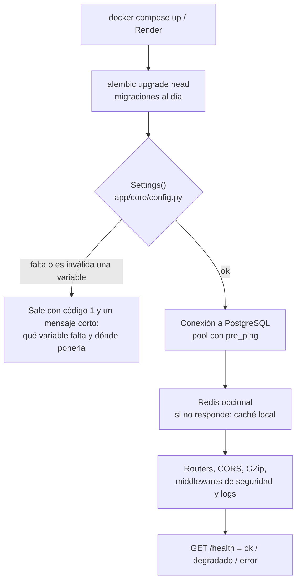

# 3. Inicialización del backend sin errores

Qué pasa cuando el backend arranca, cómo informa su estado y cómo responde
a los errores. Todo lo que se describe aquí tiene prueba automática
(`backend/tests/api/test_salud_y_configuracion_api.py`,
`test_seguridad_y_errores_api.py`).

## 3.1 Secuencia de arranque



## 3.2 Manejo de variables de entorno

- **Una sola fuente:** `app/core/config.py` (Pydantic Settings) lee el
  entorno y `backend/.env`. Las obligatorias (`DATABASE_URL`, `SECRET_KEY`,
  `ALGORITHM`, `ACCESS_TOKEN_EXPIRE_MINUTES`, `MAIL_*`) no tienen valor por
  defecto: si faltan, el backend **no arranca**.
- **Mensaje claro, sin traceback:** antes, una variable faltante tumbaba el
  proceso con un traceback de Pydantic. Ahora termina así:

  ```text
  [AlekTours] No se pudo iniciar el backend: revisa las variables de entorno.
    - DATABASE_URL: falta definirla
  Copia backend/.env.example a backend/.env (desarrollo) o defínelas en el hosting
  (Render: Environment). Guía: docs/entrega-final/04-despliegue-y-variables.md
  ```

- **Validación de seguridad:** `SECRET_KEY` con menos de 32 caracteres se
  rechaza al arrancar (un secreto corto permite falsificar tokens JWT).
- **Opcionales con valor seguro por defecto:** `REDIS_URL`, `CLOUDINARY_URL`
  (si falta, imágenes en disco), `SENTRY_DSN` (si falta, sin Sentry),
  `BREVO_API_KEY` (si falta, SMTP), `CORS_ORIGINS`, `RATE_LIMIT_MULTIPLIER`.
- **Ejemplo versionado y sin secretos:** [`backend/.env.example`](../../backend/.env.example);
  el `.env` real está en `.gitignore`. Lista completa en [`04-despliegue-y-variables.md`](04-despliegue-y-variables.md).

## 3.3 Estados del servicio (`GET /health`)

| Estado | HTTP | Cuándo | Qué hace el hosting |
|---|---|---|---|
| `{"status":"ok","database":"up","cache":"up"}` | 200 | Todo responde | Sirve tráfico |
| `{"status":"degradado","database":"up","cache":"down"}` | 200 | Redis no responde: el backend sigue con caché en memoria | Sirve tráfico (no reinicia por un componente opcional) |
| `{"status":"error","database":"down",...}` | 503 | Sin base de datos | El `HEALTHCHECK` del Dockerfile y Render marcan el contenedor como no sano |

## 3.4 Mensajes de error de la API (contrato)

| Situación | Código | Cuerpo |
|---|---|---|
| Datos inválidos (Pydantic) | 422 | `{"detail": [{"loc": [...], "msg": "...", "type": "..."}]}` con el campo que falló |
| Sin sesión o token vencido | 401 | `{"detail": "..."}` y el frontend redirige al login |
| Rol insuficiente | 403 | `{"detail": "Requiere rol de administrador"}` |
| Recurso inexistente | 404 | `{"detail": "... no encontrado"}` |
| Conflicto de negocio (fechas cruzadas, duplicado) | 409 | Mensaje en español que el frontend muestra tal cual |
| Demasiados intentos | 429 | `{"detail": ...}` con `Retry-After` |
| Error no controlado | 500 | Mensaje genérico; el detalle solo va al log (nunca SQL ni rutas internas) |

## 3.5 Secciones pendientes

No hay endpoints "por implementar": `grep -rn "TODO\|NotImplemented" backend/app`
no encuentra tareas abiertas, y todos los módulos del panel tienen
`ready: true`. Las mejoras que quedan están priorizadas como deuda técnica en
[`14-reflexion-backends-y-deuda-tecnica.md`](14-reflexion-backends-y-deuda-tecnica.md).
