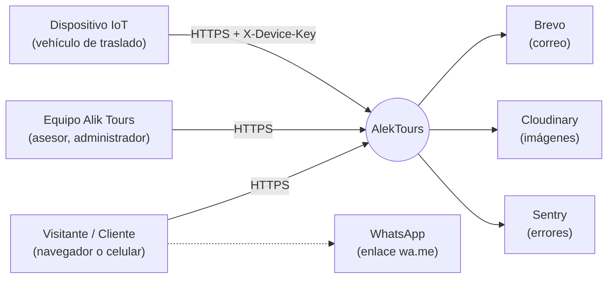
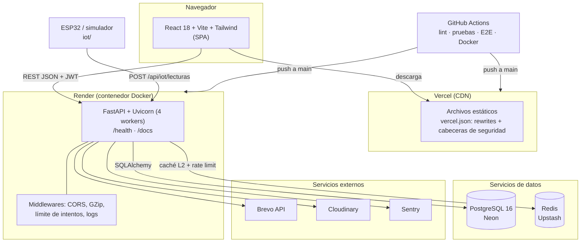
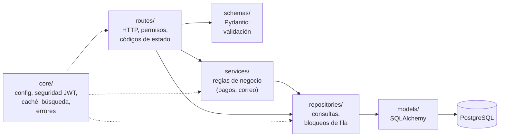
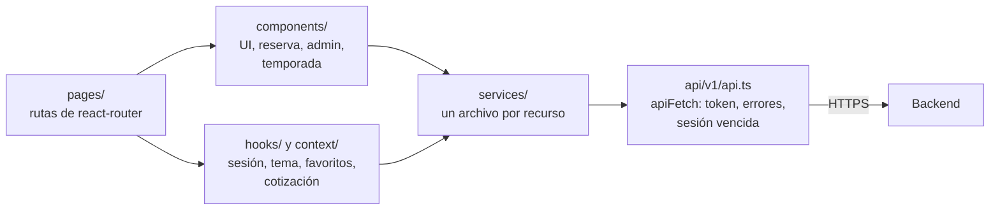

# 5. Diagrama de arquitectura

AlekTours aplica lo visto en las formaciones previas: **arquitectura por
capas** en el backend (rutas → esquemas → servicios → repositorios → modelos),
**SPA** con componentes y servicios en el frontend, **API REST** con JWT,
contenedores Docker, CI/CD y servicios gestionados en la nube. Detalle y
decisiones: [`docs/referencia-tecnica/architecture.md`](../referencia-tecnica/architecture.md)
y [`docs/conceptos/patrones-arquitectonicos.md`](../conceptos/patrones-arquitectonicos.md).

## 1. Vista de contexto

## 2. Despliegue

## 3. Capas del backend

## 4. Capas del frontend

## 5. Decisiones que vienen de formaciones previas

| Concepto | Cómo se aplica |
|---|---|
| Separación por capas y responsabilidad única | Rutas sin SQL; repositorios sin HTTP; esquemas solo validan |
| Patrón repositorio + dobles de prueba | `tests/fakes.py` y `test_dobles_repositorio.py` prueban reglas sin base de datos |
| Seguridad (OWASP Top 10) | JWT con secreto fuerte, roles verificados en BD, límites de intentos, errores sin filtraciones, archivos privados con permiso ([`owasp-top-10.md`](../conceptos/owasp-top-10.md)) |
| Normalización y modelo relacional | 55 tablas con FK y CHECK; migraciones Alembic ([MER/MR](01b-modelo-de-datos.md)) |
| Accesibilidad (WCAG) | Roles ARIA, foco visible, contraste verificado por pruebas ([`accesibilidad-aria-wcag.md`](../conceptos/accesibilidad-aria-wcag.md)) |
| Contenedores e infraestructura como código | `Dockerfile` multi-etapa, `docker-compose*.yml`, workflows de GitHub |
| IoT | Dispositivo → HTTP/JSON → API → base de datos → panel ([`06-iot.md`](06-iot.md)) |
