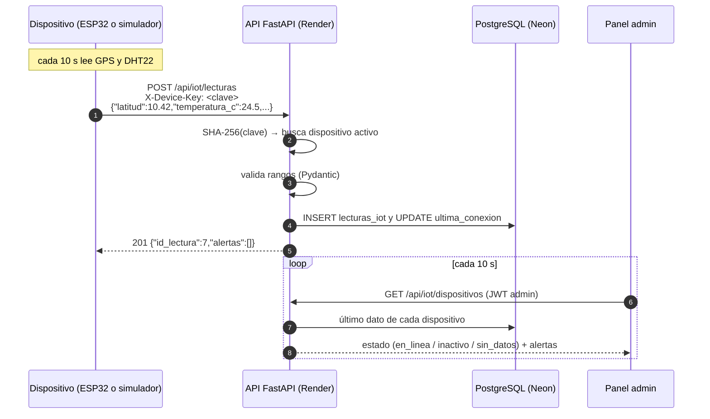

# 6. Bonificación — IoT: telemetría de los vehículos de traslado

**Qué resuelve:** Alik Tours hace traslados aeropuerto–hotel. Cada vehículo
lleva un dispositivo que reporta posición, velocidad, temperatura y humedad
de cabina, pasajeros a bordo y batería. El panel muestra el estado de cada
vehículo en tiempo casi real y alerta si la cabina pasa de 28 °C, si supera
100 km/h o si la batería baja de 15 %.

| Pieza | Archivo |
|---|---|
| Firmware del prototipo físico (MicroPython, ESP32 + GPS NEO-6M + DHT22) | [`iot/esp32/main.py`](../../iot/esp32/main.py) |
| Simulador del dispositivo (Python, solo biblioteca estándar) | [`iot/simulador_traslado.py`](../../iot/simulador_traslado.py) |
| API que recibe y entrega los datos | [`backend/app/routes/iot_route.py`](../../backend/app/routes/iot_route.py) |
| Tablas `dispositivos_iot` y `lecturas_iot` | [`iot_model.py`](../../backend/app/models/iot_model.py), migración `b7e2c9d4f1a6` |
| Panel (admin › Telemetría IoT) | [`ModuleIoT.tsx`](../../alecktourfrondend/src/app/components/admin/ModuleIoT.tsx) |
| Pruebas | `backend/tests/api/test_iot_api.py` (14 casos), `tests/unit/test_simulador_iot.py` (3), `ModuleIoT.test.tsx` (2) |

## 6.1 Flujo de datos



## 6.2 Protocolo de comunicación

**Por qué HTTP y no MQTT:** el backend ya está publicado con HTTPS en Render
y el plan gratis no permite abrir otro puerto ni mantener un broker. HTTP
con JSON funciona en el ESP32 (`urequests`), pasa por cualquier red WiFi o
celular y reutiliza la validación, el límite de intentos y los registros
del backend. MQTT sería la opción si hubiera muchos dispositivos con
reportes cada segundo (ver deuda técnica DT-08).

| Capa | Elección |
|---|---|
| Transporte | HTTP/1.1 sobre TLS (HTTPS) en producción; HTTP en local |
| Método y ruta | `POST /api/iot/lecturas` |
| Formato | JSON (`Content-Type: application/json`), campos en español, unidades del SI en el nombre (`_c`, `_kmh`, `_pct`) |
| Autenticación | Cabecera `X-Device-Key` con una clave de 43 caracteres por dispositivo. El servidor guarda solo su SHA-256; la clave se muestra una vez al registrar el dispositivo. Desactivar el dispositivo la invalida |
| Frecuencia | Cada 10 s (ESP32) o configurable (`--intervalo` en el simulador) |
| Límite | 120 lecturas por minuto por IP (respuesta 429 con `Retry-After`) |
| Reintentos | Sin red: el simulador reintenta 3 veces con espera exponencial (2, 4, 8 s); con 401 se detiene |
| Hora | `medido_en` (opcional, la del dispositivo) y `recibido_en` (la del servidor) |

**Cuerpo de la lectura** (todos opcionales, al menos uno; latitud y longitud van juntas):

| Campo | Tipo | Rango |
|---|---|---|
| `medido_en` | fecha-hora ISO 8601 | — |
| `latitud`, `longitud` | número | −90…90, −180…180 |
| `velocidad_kmh` | número | 0…250 |
| `temperatura_c` | número | −40…85 (rango del DHT22) |
| `humedad_pct` | número | 0…100 |
| `pasajeros` | entero | 0…80 |
| `bateria_pct` | número | 0…100 |

**Respuestas:**

| Código | Cuándo | Cuerpo |
|---|---|---|
| 201 | Lectura guardada | `{"id_lectura": 7, "recibido_en": "...", "alertas": ["Temperatura de cabina alta (30.1 °C)"]}` |
| 401 | Sin `X-Device-Key`, clave falsa o dispositivo desactivado | `{"detail": "Dispositivo no autorizado"}` |
| 422 | Valor fuera de rango, lectura vacía, campo desconocido o latitud sin longitud | Detalle de Pydantic con el campo |
| 429 | Más de 120 lecturas por minuto | `Retry-After` |

Endpoints del panel (JWT de administrador): `GET /api/iot/dispositivos`,
`POST /api/iot/dispositivos`, `PATCH /api/iot/dispositivos/{id}/activo?activo=false`,
`GET /api/iot/dispositivos/{id}/lecturas?limite=50`.

## 6.3 Cómo probarlo (los datos llegan al sistema)

```bash
# 1. Backend corriendo (local o Render). Registrar el dispositivo con un token de admin:
curl -X POST http://localhost:8000/api/iot/dispositivos \
  -H "Authorization: Bearer $TOKEN_ADMIN" -H "Content-Type: application/json" \
  -d '{"nombre":"Van de traslados 01","descripcion":"Aeropuerto - Centro Histórico, Cartagena"}'
# → guarda el campo "clave" (no se vuelve a mostrar)

# 2. Enviar lecturas con el simulador (recorre aeropuerto → Centro Histórico)
python iot/simulador_traslado.py --clave <CLAVE> --lecturas 12 --intervalo 3
python iot/simulador_traslado.py --clave <CLAVE> --lecturas 2 --calor   # dispara la alerta

# 3. Ver los datos: /admin › Telemetría IoT (se actualiza sola cada 10 s)
```

Salida real de una corrida local (20 nov 2026):

```text
[1] 201 lectura #1 (10.442486, -75.512815) 21.8 °C
[2] 201 lectura #2 (10.433916, -75.523559) 24.2 °C
[3] 201 lectura #3 (10.423314, -75.542168) 21.1 °C
[4] 201 lectura #4 (10.420668, -75.549658) 24.3 °C
[5] 201 lectura #5 (10.425185, -75.548999) 22.9 °C
[1] 201 lectura #6 (10.442237, -75.513181) 29.4 °C ALERTAS: Temperatura de cabina alta (29.4 °C)
[2] 201 lectura #7 (10.425032, -75.549196) 30.1 °C ALERTAS: Temperatura de cabina alta (30.1 °C)
```

Con clave inválida: `[1] 401 Dispositivo no autorizado` y el simulador termina con código 2.

## 6.4 Prototipo físico (ESP32)

Conexiones: GPS NEO-6M TX→GPIO16, RX→GPIO17 (UART2, 9600 baudios); DHT22
datos→GPIO4 con resistencia de 10 kΩ a 3,3 V. Flashear MicroPython, copiar
`main.py` y `config.py` (desde `config.example.py`, con WiFi, URL y clave).
El firmware convierte las frases `$GPRMC` del GPS a grados decimales y la
velocidad de nudos a km/h, y envía el mismo JSON que el simulador.
