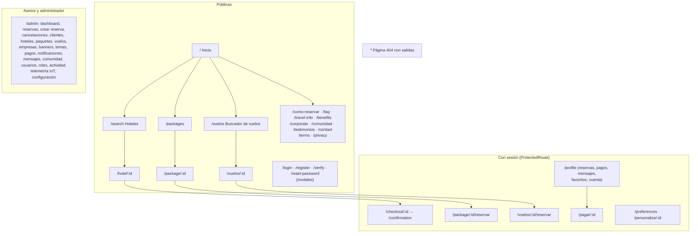
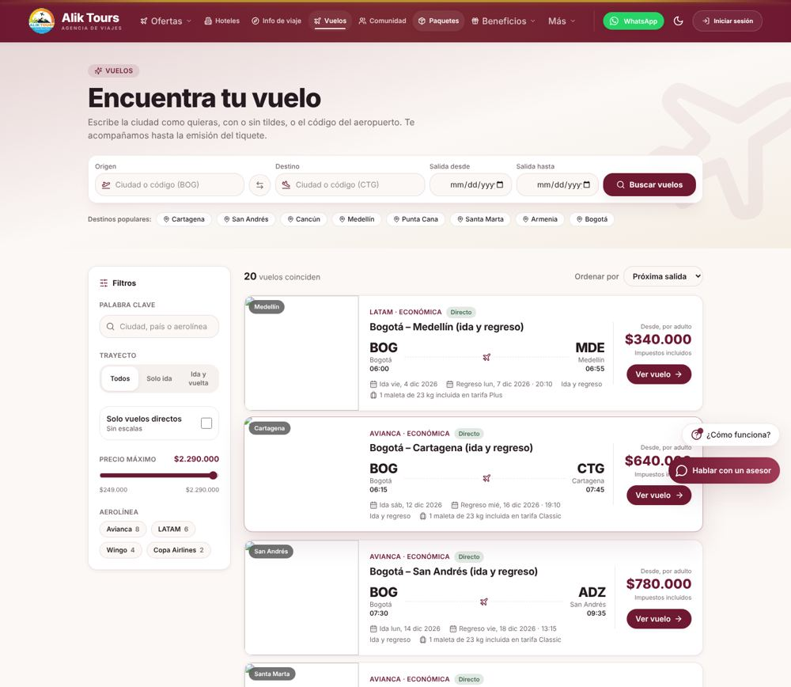
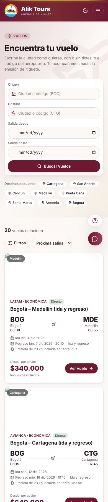
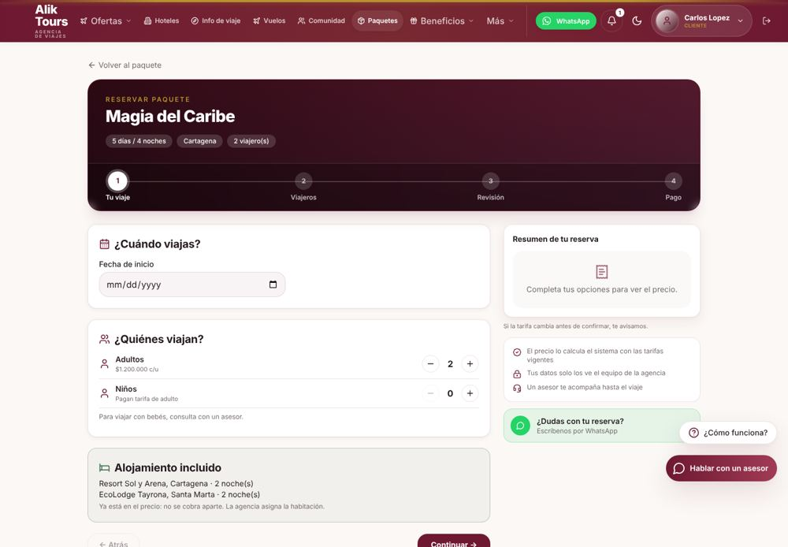
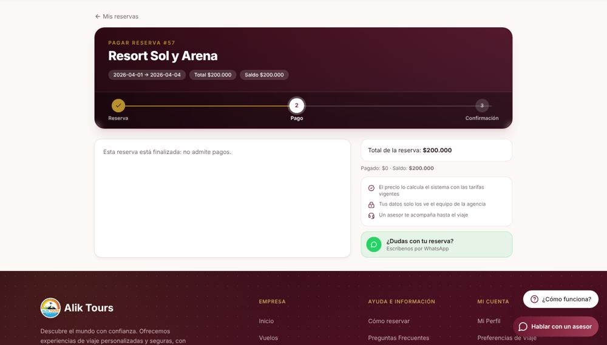
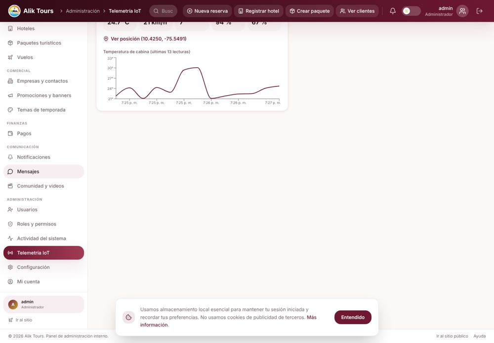

# 10. Front-end: pantallas, enrutamiento, navegación, colores, UX y UI

React 18 + Vite + TypeScript + Tailwind, `react-router` con carga diferida
(`lazy`) por ruta, animaciones con `motion` y componentes accesibles de
Radix/shadcn. Guía visual: [`design-system.md`](../referencia-tecnica/design-system.md).

## 10.1 Mapa de rutas y navegación

31 rutas en [`routes.tsx`](../../alecktourfrondend/src/app/routes.tsx). Reglas
de navegación:

- **Rutas protegidas** (`ProtectedRoute`): sin sesión llevan al inicio y abren
  el modal de login una sola vez.
- **Roles:** un administrador o asesor que entra a una ruta de cliente va a su
  panel; el asesor ve un panel recortado (sin catálogo ni usuarios).
- **Estado en la URL:** los filtros de hoteles y de vuelos viven en la URL
  (`/vuelos?destino=cartagena&orden=precio&trayecto=solo_ida`), así se pueden
  compartir, sobreviven a recargar y el botón Atrás funciona.
- **Errores:** `RouteErrorBoundary` por ruta y página 404 con salidas al
  inicio y a soporte.

## 10.2 Colores y tipografía

| Token | Claro | Oscuro | Uso |
|---|---|---|---|
| `--primary` | `#6e1832` (vino) | `#c24d6e` | Botones principales, enlaces, encabezados de reserva |
| `--gold` | `#b8912e` | `#e8c77a` | Acentos de marca, pasos completados, etiquetas |
| `--background` | `#fbf8f6` | `#0f0f10` | Fondo |
| `--foreground` | `#241a1f` | `#f5f5f5` | Texto |
| `--secondary` / `--accent` | `#f4e7eb` / `#f6ecd9` | `#241a1e` / `#2e1e15` | Superficies suaves, chips |
| `--success` | `#3f6b4a` | `#5fae76` | Confirmaciones, "Directo" |

- Tipografía **Plus Jakarta Sans**.
- **Modo oscuro** con selector en la barra superior.
- **Temas de temporada** (Navidad, Fin de año…) que el administrador activa
  desde el panel y que cambian la paleta y los adornos.
- El **contraste** de cada tema se verifica con pruebas (`contrasteWcag.test.ts`, WCAG AA).

## 10.3 Pantallas principales

| Pantalla | Captura |
|---|---|
| Buscador de vuelos: búsqueda sin tildes, destinos populares, filtros (palabra clave, trayecto, directos, precio máximo, aerolínea con conteo), orden, chips de filtros activos, total de coincidencias y paginación |  |
| Vuelos en celular: los filtros se abren con un botón y muestran cuántos hay activos |  |
| Reservar paquete: encabezado con foto y pasos con barra de progreso, resumen fijo, garantías y ayuda por WhatsApp |  |
| Pagar reserva: mismo encabezado con pasos Reserva → Pago → Confirmación |  |
| Panel: telemetría IoT con alertas y gráfica de temperatura |  |

> En las capturas las fotos de Unsplash/Cloudinary no cargan porque el
> entorno de captura no tiene salida a esos dominios; en producción sí se ven.

## 10.4 Decisiones de UX

| Decisión | Por qué |
|---|---|
| El precio lo calcula siempre el backend y se muestra desglosado | Lo que ves es lo que se cobra; nada de sumas en el navegador |
| Pasos visibles con progreso en todas las reservas | La persona sabe cuánto falta (hotel: 4 pasos; paquete: 4; vuelo: 3; pago: 3) |
| Resumen fijo a la derecha (abajo en celular) con foto del producto | Confirma qué se está comprando sin volver atrás |
| Garantías solo verdaderas ("el precio lo calcula el sistema", "tus datos solo los ve la agencia") | No se prometen cosas que el sistema no hace |
| Búsqueda tolerante (sin tildes ni mayúsculas, ciudad, país, código IATA o aerolínea) | Las personas escriben "bogota" o "san andres" |
| Estados vacíos con salida ("Quitar filtros", "un asesor te cotiza") | Nunca un callejón sin salida |
| Esqueletos de carga y resultados que se atenúan mientras se filtra | La pantalla no salta |
| Accesibilidad: etiquetas en todos los campos, `aria-live` en totales, `aria-current="step"`, foco visible, `prefers-reduced-motion` | Uso con teclado y lector de pantalla; respeto a quien desactiva animaciones |
| Carga diferida por ruta y modales de autenticación diferidos | Menos JavaScript en la primera visita |
