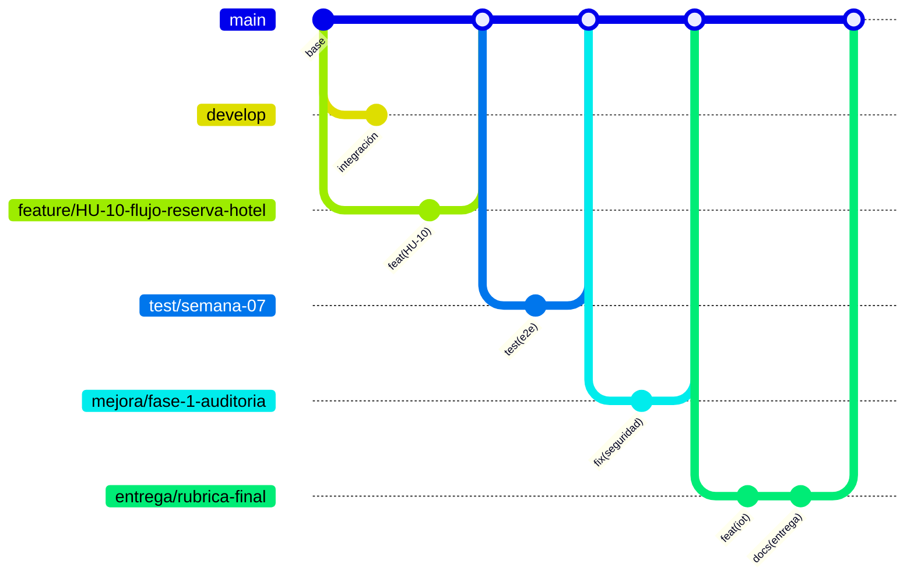

# 12. Manejo del repositorio: ramas y commits

Repositorio: [github.com/Juan-Pablo-Castillo-Velasquez/Alik-Tours](https://github.com/Juan-Pablo-Castillo-Velasquez/Alik-Tours).
Guía del flujo: [`docs/colaboracion/flujo-github.md`](../colaboracion/flujo-github.md) y [`CONTRIBUTING.md`](../../CONTRIBUTING.md).

## 12.1 Cifras (20 nov 2026)

| Dato | Valor |
|---|---|
| Commits en `main` | 385 (más los de la rama de entrega) |
| Ramas remotas | 39 |
| Pull requests | 31 (24 integrados) |
| Issues | 13 de trabajo y 24 de defectos (#45–#68) con etiquetas |
| Commits con prefijo convencional (`feat`, `fix`, `docs`, `test`, `chore`, `ci`…) | 278 de 385 (los primeros meses no seguían la convención) |
| CI | 4 workflows: lint + Docker, pruebas con cobertura + integración + E2E, auditoría de dependencias, mantener el backend activo |

## 12.2 Estrategia de ramas

| Prefijo de rama | Para qué | Ejemplos reales |
|---|---|---|
| `feature/HU-NN-…` | Una historia de usuario | `feature/HU-01-login-por-correo` … `feature/HU-11-pagos-simulados` |
| `feat/…` | Funcionalidad sin HU numerada | `feat/comunidad-videos-resenas` |
| `test/semana-NN` | Pruebas de cada semana del bootcamp | `test/semana-01` … `test/semana-09` |
| `mejora/…` | Auditoría y mejoras por fases | `mejora/fase-1-auditoria`, `mejora/notificaciones`, `mejora/panel-orden` |
| `chore/…` | Mantenimiento | `chore/diagnostico-render`, `chore/revisar-enlaces` |
| `entrega/…` | Entrega final | `entrega/rubrica-final` |
| `develop`, `STG` | Integración y staging | — |

`main` es producción (Vercel y Render despliegan en cada push), por eso todo
entra por PR con el CI en verde.

## 12.3 Commits

Convención [Conventional Commits](https://www.conventionalcommits.org/es/)
en español con alcance: `feat(vuelos): …`, `fix(registro): …`,
`test(api): …`, `docs(entrega): …`, `ci: …`. El mensaje dice qué cambia y
por qué; si corrige un defecto, lo nombra (`DEF-17`, `#61`) para que el PR
cierre el issue al integrarse.

## 12.4 Pull requests

Plantilla en [`.github/pull_request_template.md`](../../.github/pull_request_template.md).
Cada PR: descripción, issues que cierra (`Closes #61`), cómo se probó, y CI en
verde. En el bootcamp, quien revisa un PR de pruebas debe haber trabajado en
otra capa esa semana ([matriz de rotación](../matriz-rotacion.md)).
