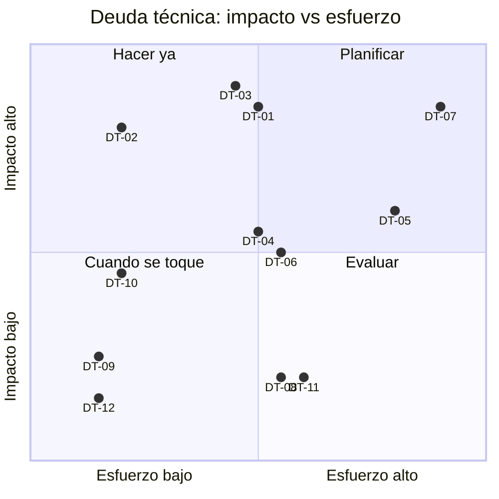

# 14. Reflexión comparativa de los 4 backends y deuda técnica

## 14.1 Los cuatro backends

En el programa (Tecnólogo ADSO) y en el Bootcamp Testing ADSO se trabajaron
backends en **FastAPI, Express y Spring Boot** (los stacks de los proyectos
de referencia del bootcamp); el cuarto es el de **AlekTours**, en FastAPI,
que es el que se entrega y documenta. Como cuarto punto de comparación se
incluye **Django**, la alternativa que el equipo evaluó al elegir el
framework ([`architecture.md`](../referencia-tecnica/architecture.md#por-qué-fastapi-y-no-django-o-flask)).

> Si en tu ficha los cuatro backends fueron otros, cambia la columna que
> corresponda: el análisis de AlekTours (FastAPI) y la deuda técnica no
> dependen de eso.

| Criterio | **FastAPI** (AlekTours) | **Express** (Node.js) | **Spring Boot** (Java) | **Django + DRF** (Python) |
|---|---|---|---|---|
| Lenguaje y tipado | Python con anotaciones de tipo que FastAPI usa de verdad (validación y documentación) | JavaScript/TypeScript; los tipos de TS no existen en ejecución | Java, tipado estático fuerte y compilado | Python; los tipos no guían la validación |
| Validación de entrada | Automática con Pydantic desde los esquemas (422 con el campo exacto) | Manual o con librería aparte (zod, joi, express-validator) | Bean Validation (`@Valid`, `@NotNull`) | Serializers de DRF |
| Acceso a datos | SQLAlchemy 2 + Alembic (migraciones explícitas, revisables) | A elegir: Prisma, TypeORM, Sequelize | Spring Data JPA / Hibernate + Flyway o Liquibase | ORM de Django con migraciones automáticas |
| Documentación de la API | OpenAPI y Swagger **generados solos** (`/docs`); con eso se generó la referencia de 221 operaciones | Manual (swagger-jsdoc) o con NestJS | springdoc-openapi con anotaciones | drf-spectacular |
| Concurrencia | ASGI asíncrono; en AlekTours la mayoría de rutas son síncronas sobre un pool de hilos | Event loop de un hilo, muy bueno para E/S | Hilos (y virtual threads en Java 21) | WSGI síncrono por defecto; ASGI parcial |
| Estructura | Libre: la arquitectura por capas la impone el equipo | Libre (minimalista) | Muy guiada (controladores, servicios, repositorios, inyección de dependencias) | Muy guiada ("baterías incluidas": admin, auth, ORM) |
| Pruebas | pytest + `TestClient` + `dependency_overrides` para cambiar la BD o el correo en una línea | Jest/Vitest + Supertest | JUnit 5 + MockMvc + Testcontainers | pytest-django / `APITestCase` |
| Arranque y memoria | Rápido y liviano: cabe en el plan gratis de Render | Muy rápido y liviano | Arranque más lento y más memoria (JVM); el plan gratis se queda corto | Liviano |
| Curva de aprendizaje | Baja si se sabe Python y tipos | Baja para empezar, alta para mantener el orden | Alta (anotaciones, contenedor de Spring) | Media (muchas convenciones propias) |

### Lo que aprendimos al hacer AlekTours en FastAPI

1. **Los tipos pagan solos.** Un mismo esquema Pydantic valida, documenta y
   le dice al frontend qué esperar. Los defectos DEF-04 y DEF-06 (contraseña
   sin validar en el backend, textos más largos que la columna) se
   cerraron agregando una regla al esquema, sin tocar las rutas.
2. **La libertad hay que ordenarla.** FastAPI no impone capas: el equipo
   decidió separar rutas, servicios y repositorios, y eso hizo posibles los
   dobles de prueba (`test_dobles_repositorio.py`). Aun así quedan rutas que
   consultan la base directamente (vuelos, IoT). Spring Boot da ese orden
   desde el primer día, a cambio de más ceremonia.
3. **SQLite en pruebas no es PostgreSQL.** La suite rápida corre en SQLite,
   pero los CHECK (DEF-07), las longitudes (DEF-06) y las tildes (DEF-18) solo
   aparecieron contra PostgreSQL real. Por eso existe la capa de integración
   con `docker-compose.test.yml`. En Spring, Testcontainers resuelve lo mismo.
4. **Las migraciones explícitas protegen producción.** Alembic obliga a
   revisar cada cambio de esquema; el costo es mantener modelos y migraciones
   sincronizados (DEF-24 / DT-02). Django lo automatiza más, pero con menos
   control.
5. **Para un equipo pequeño con hosting gratis, FastAPI fue la elección
   correcta:** poca memoria, documentación gratis y el mismo lenguaje de los
   scripts del equipo (simulador IoT, generadores de documentación).
   Elegiríamos Spring Boot en una empresa con equipo Java y presupuesto de
   infraestructura, y Express si todo el equipo trabajara solo en TypeScript.

## 14.2 Deuda técnica documentada y priorizada

Prioridad = impacto × urgencia, ajustada por el esfuerzo (P1 = hacer ya).

| ID | Deuda | Impacto | Esfuerzo | Prioridad | Plan |
|---|---|---|---|---|---|
| DT-01 | **El build del frontend no revisa tipos** (`vite build` sin `tsc`): un error de tipos llega a producción si no lo ve ESLint | Alto | Medio (agregar `tsconfig` estricto y `tsc --noEmit` al CI, corregir lo que salga) | **P1** | Sprint siguiente |
| DT-02 | **Índices de migraciones no declarados en los modelos** (DEF-24, [#68](https://github.com/Juan-Pablo-Castillo-Velasquez/Alik-Tours/issues/68)): un `--autogenerate` los borraría | Alto | Bajo | **P1** | Declarar 9 `Index(...)` y poner `alembic check` en el CI |
| DT-03 | **Datos de demostración** en el catálogo (hoteles y paquetes de relleno) | Alto para salir a vender | Medio (lo carga la agencia desde el panel) | **P1** | Antes del lanzamiento comercial |
| DT-04 | **Registro en dos peticiones** (cuenta y perfil por separado). DEF-17 se mitigó en el frontend, pero el backend debería crear ambos en una sola transacción | Medio | Medio | P2 | Endpoint `POST /auth/register` con datos del cliente |
| DT-05 | **Token en `localStorage`**: un XSS podría leerlo. Mitigado con CSP en `vercel.json` | Medio (seguridad) | Alto (cookies `HttpOnly` + CSRF + cambios en `apiFetch`) | P2 | Evaluar al integrar pasarela de pagos |
| DT-06 | **Archivos muy grandes**: `Checkout.tsx` (1.579 líneas), `reserva_route.py` (1.593), `Admindashboard.tsx` (1.042) | Medio (mantenimiento) | Medio | P2 | Partir por pasos/módulos al tocar cada uno |
| DT-07 | **Pagos simulados y asistidos por asesor** (sin pasarela real) | Alto para el negocio | Alto (Wompi/PayU, webhooks, conciliación) | P2 | Decisión de la agencia; hoy es intencional |
| DT-08 | **IoT por HTTP con consulta cada 10 s** desde el panel | Bajo (pocos vehículos) | Medio | P3 | MQTT + WebSocket si pasan de ~20 dispositivos o se reporta cada segundo |
| DT-09 | **Búsquedas del panel** (reservas, mensajes) aún distinguen tildes (usan `ILIKE`) | Bajo | Bajo (usar `app/core/busqueda.py`) | P3 | Junto con DT-02 |
| DT-10 | **Plan gratis de Render**: el backend se duerme a los 15 min (primer request ~1 min) | Medio (experiencia) | Bajo en esfuerzo, con costo mensual | P3 | Plan pago o Railway al lanzar |
| DT-11 | **Dos librerías de UI** (shadcn/Radix y MUI) | Bajo (peso del bundle) | Medio | P3 | Migrar lo de MUI a shadcn poco a poco |
| DT-12 | **356 advertencias de ESLint** (0 errores; sobre todo `any` y exportaciones mezcladas con componentes) | Bajo | Bajo | P3 | Limpiar al tocar cada archivo |

Deuda pagada en esta entrega: búsqueda sin tildes en hoteles y vuelos
(DEF-18, DEF-20), registro bloqueado por cédula repetida (DEF-17), código de
reserva inventado (DEF-19), arranque con mensajes claros y `/health` con
estados (DEF-21, DEF-23) y la configuración de Pydantic obsoleta.
