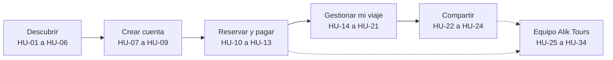

# Historias de usuario — Alik Tours

Historias de usuario del sistema **tal como está construido hoy** (frontend en Vercel, API FastAPI en Render, base de datos en Neon). Hay **un archivo por historia** y están numeradas en **orden lineal**: siguen el recorrido real de una persona, desde que descubre el sitio hasta que reseña su viaje, y después el trabajo del equipo de la agencia en el panel.

Cada archivo tiene: actor, módulo, prioridad, pantalla, endpoints de la API, la historia (*Como / quiero / para*) y los criterios de aceptación en formato *Dado / cuando / entonces*. Al final de cada una hay enlaces a la anterior y a la siguiente para leerlas en orden.

> Las HU de `docs/requisitos/HUs/` (HU-001 a HU-011) vienen de la plantilla inicial del proyecto (NN Auth System). Estas son las del producto Alik Tours completo.

## Recorrido

## 1. Descubrir (visitante)

| HU | Historia | Actor | Módulo |
| --- | --- | --- | --- |
| [HU-01](HU-01_explorar_inicio.md) | Explorar la página de inicio | Visitante | Catálogo |
| [HU-02](HU-02_buscar_hoteles.md) | Buscar hoteles por destino y fechas | Visitante | Catálogo |
| [HU-03](HU-03_ver_ficha_hotel.md) | Ver la ficha de un hotel y sus habitaciones | Visitante | Catálogo |
| [HU-04](HU-04_explorar_paquetes.md) | Explorar paquetes turísticos | Visitante | Catálogo |
| [HU-05](HU-05_consultar_vuelos.md) | Consultar ofertas de vuelos | Visitante | Vuelos |
| [HU-06](HU-06_guia_de_uso.md) | Consultar la guía de uso | Visitante / Cliente | Ayuda |

## 2. Crear cuenta

| HU | Historia | Actor | Módulo |
| --- | --- | --- | --- |
| [HU-07](HU-07_registro_y_verificacion.md) | Registrarme y verificar mi correo | Visitante | Cuentas |
| [HU-08](HU-08_inicio_sesion.md) | Iniciar sesión y recuperar mi contraseña | Cliente | Cuentas |
| [HU-09](HU-09_metodo_de_pago.md) | Registrar un método de pago | Cliente | Perfil |

## 3. Reservar y pagar

| HU | Historia | Actor | Módulo |
| --- | --- | --- | --- |
| [HU-10](HU-10_reservar_hotel.md) | Reservar un hotel | Cliente | Reservas |
| [HU-11](HU-11_reservar_paquete.md) | Reservar un paquete turístico | Cliente | Reservas |
| [HU-12](HU-12_reservar_vuelo.md) | Reservar un vuelo | Cliente | Reservas |
| [HU-13](HU-13_pagar_reserva.md) | Pagar una reserva | Cliente | Pagos |

## 4. Gestionar mi viaje (perfil)

| HU | Historia | Actor | Módulo |
| --- | --- | --- | --- |
| [HU-14](HU-14_mis_reservas.md) | Consultar mis reservas | Cliente | Perfil |
| [HU-15](HU-15_cancelar_reserva.md) | Solicitar la cancelación de una reserva | Cliente | Reservas |
| [HU-16](HU-16_chat_con_asesor.md) | Chatear con un asesor | Cliente | Comunicación |
| [HU-17](HU-17_notificaciones.md) | Recibir notificaciones | Cliente | Comunicación |
| [HU-18](HU-18_favoritos.md) | Guardar hoteles favoritos | Cliente | Perfil |
| [HU-19](HU-19_preferencias.md) | Configurar mis preferencias de viaje | Cliente | Perfil |
| [HU-20](HU-20_comprobantes.md) | Descargar mis comprobantes | Cliente | Perfil |
| [HU-21](HU-21_mi_cuenta.md) | Gestionar mi cuenta | Cliente | Perfil |

## 5. Compartir la experiencia

| HU | Historia | Actor | Módulo |
| --- | --- | --- | --- |
| [HU-22](HU-22_resena_estadia.md) | Dejar una reseña de mi estadía | Cliente | Reseñas |
| [HU-23](HU-23_comunidad.md) | Publicar en la comunidad viajera | Cliente | Comunidad |
| [HU-24](HU-24_contacto_y_corporativo.md) | Contactar a la agencia y pedir planes corporativos | Visitante | Comercial |

## 6. Operar la agencia (equipo Alik Tours)

| HU | Historia | Actor | Módulo |
| --- | --- | --- | --- |
| [HU-25](HU-25_moderar_resenas_y_comunidad.md) | Moderar reseñas y publicaciones | Asesor / Administrador | Comunidad |
| [HU-26](HU-26_gestionar_hoteles.md) | Gestionar hoteles y habitaciones | Administrador | Productos |
| [HU-27](HU-27_gestionar_paquetes.md) | Gestionar paquetes turísticos | Administrador | Productos |
| [HU-28](HU-28_gestionar_vuelos.md) | Gestionar ofertas aéreas | Administrador | Productos |
| [HU-29](HU-29_gestionar_reservas_y_pagos.md) | Gestionar reservas y pagos | Asesor / Administrador | Operaciones |
| [HU-30](HU-30_atender_cancelaciones.md) | Atender solicitudes de cancelación | Asesor / Administrador | Operaciones |
| [HU-31](HU-31_promociones_y_temas.md) | Gestionar promociones, banners y temas de temporada | Administrador | Comercial |
| [HU-32](HU-32_dashboard.md) | Consultar el dashboard de indicadores | Administrador | Operaciones |
| [HU-33](HU-33_usuarios_y_roles.md) | Gestionar usuarios, roles y permisos | Administrador | Administración |
| [HU-34](HU-34_configuracion_agencia.md) | Configurar los datos de la agencia | Administrador | Administración |

## 7. Transversal

| HU | Historia | Actor | Módulo |
| --- | --- | --- | --- |
| [HU-35](HU-35_rendimiento.md) | Navegar el sitio con rapidez | Visitante / Cliente | Plataforma |

## Cómo usar estas historias

- **Para probar**: cada criterio de aceptación es un caso de prueba (manual o E2E en `/e2e`). El identificador `CA-XX.Y` sirve para referenciarlo en los reportes del bootcamp de testing.
- **Para cambiar algo**: si una funcionalidad cambia, actualiza su HU en el mismo commit. Si es nueva, crea la siguiente (`HU-36_...`) en el lugar del recorrido que le corresponda y enlázala en este índice.
- **Manual para personas usuarias**: [docs/manual-usuario/README.md](../manual-usuario/README.md).
